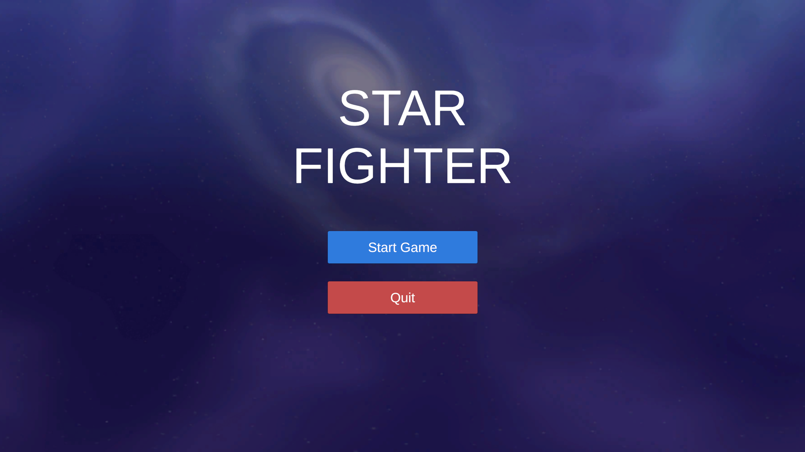
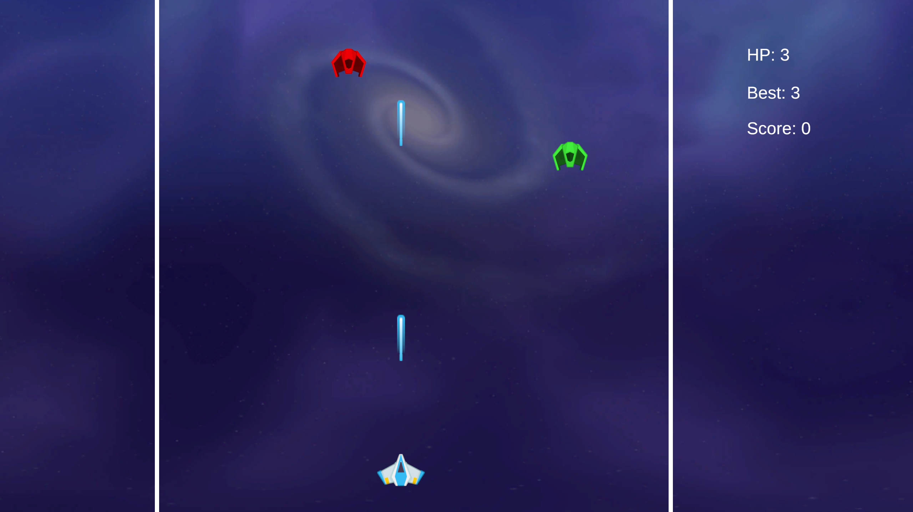
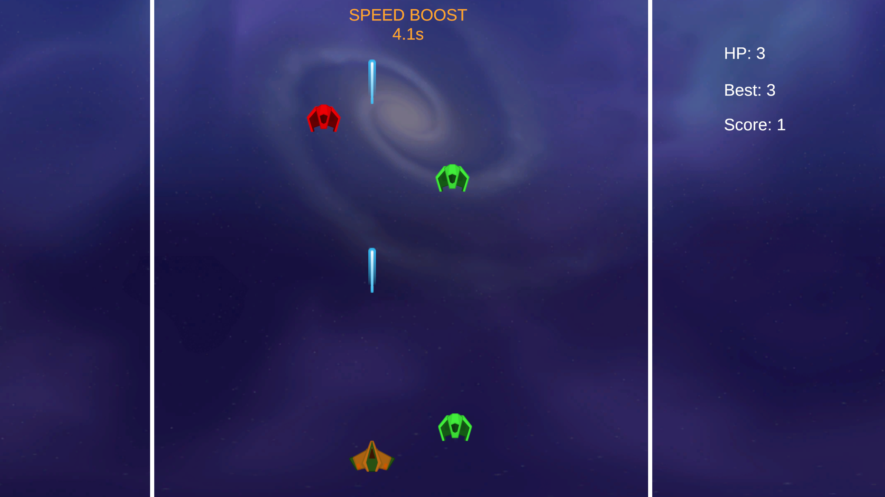
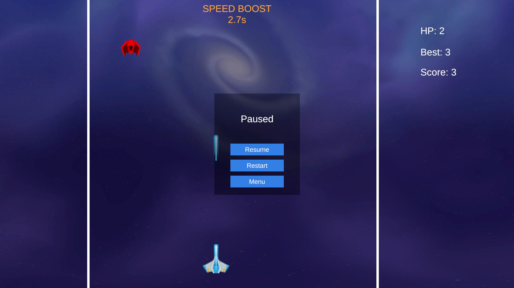
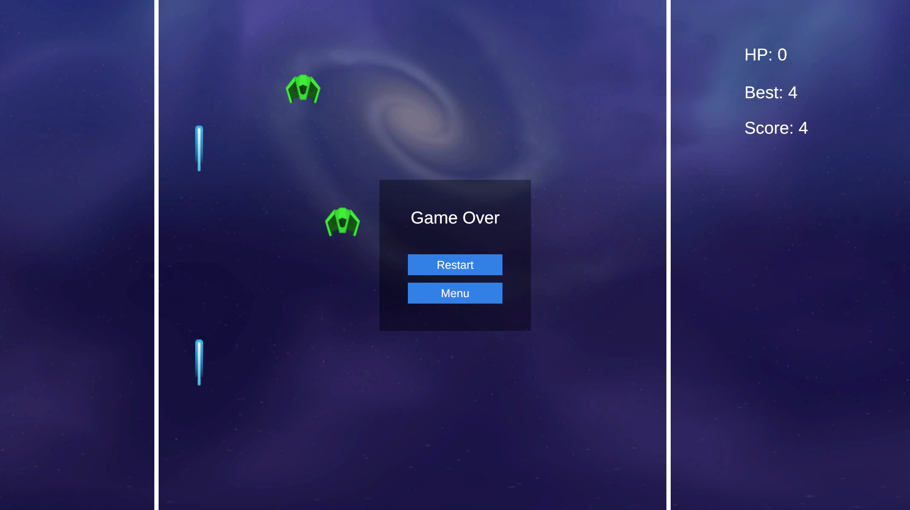

# StarFighter

> Unity 6 + URP 2D 写的竖版飞机射击游戏。玩家操控的飞船自动开火，方向键控制移动，击落从上方下落的敌机得分。敌机有三种飞法，击杀敌机会概率掉回血或加速射击的道具，分数越高难度越大，最高分存在本地。


## 目录

- [一、项目介绍](#一项目介绍)
- [二、玩法与规则](#二玩法与规则)
- [三、游戏截图](#三游戏截图)
- [四、敌机与难度曲线](#四敌机与难度曲线)
- [五、操作](#五操作)
- [六、技术栈](#六技术栈)
- [七、架构与设计](#七架构与设计)
- [八、项目结构](#八项目结构)
- [九、本地运行](#九本地运行)
- [十、素材来源](#十素材来源)
- [十一、已知取舍](#十一已知取舍)
- [十二、说明](#十二说明)

---

## 一、项目介绍

打开主菜单，点 Start 进战斗。玩家飞船在屏幕上活动，子弹自动发射，敌机从顶部往下掉，击杀敌机加分。三种敌机走法不同，打死有概率掉道具，捡到能回血或者短时间加快射击。分数越高敌机掉得越快、刷得越密，生命值清零进入结算界面。

两个场景：`MainMenu` 和 `GameScene`。15 个 C# 脚本，1130 行。

---

## 二、玩法与规则

- 初始 3 点生命，HUD 右上角竖排显示生命、最高分和当前分数。
- 飞船自动开火，初始 0.5 秒一发，没有开火键。
- 击落敌机加分，敌机从屏幕底部漏过扣 1 点，撞上飞船也扣 1 点，撞完敌机消失。
- 受伤后进入 1.5 秒无敌，期间飞船透明度闪烁，不会再掉血。
- 击落敌机有 20% 概率掉落道具，其中 30% 是火力强化，70% 是回血。
- 回血道具恢复 1 点血量，上限 3 点，满血时拾取无效。
- 火力强化把射击间隔缩短 0.05 秒，最低 0.1 秒，持续 5 秒。重复拾取会叠加并重置倒计时，拾取 8 次到达下限。期间飞船橙色并轻微闪烁，屏幕顶部显示剩余秒数。
- 生命归零进入结算面板，可点 Restart 重开、Menu 回主菜单，也可以按 R 重开。

---

## 三、游戏截图

> 以下为游戏内截图，图片存放于仓库 `docs/screenshots/` 目录。

| 截图 | 说明 |
| --- | --- |
|  | 主菜单（Start / Quit） |
|  | 战斗画面（HUD、敌机、子弹） |
|  | 拾取强化道具（飞船橙色闪烁、顶部倒计时） |
|  | 暂停面板（Resume / Restart / Menu） |
|  | 结算面板 |

---

## 四、敌机与难度曲线

三种敌机各对应一份 ScriptableObject 配置，数值在 `Assets/Enemy_*.asset` 里改。

| 类型                  | 下落速度 | 击杀得分 | 颜色 | 移动方式                                      |
| ------------------- | ---- | ---- | -- | ----------------------------------------- |
| 直线 `Enemy_Straight` | 3    | 1    | 白色 | 匀速下落                                      |
| 之字 `Enemy_Zigzag`   | 2    | 1    | 绿色 | 纵向匀速下落，横向按正弦摆动，幅度 1.5，角频率 3（周期约 2.1 秒）    |
| 俯冲 `Enemy_Chase`    | 3    | 1    | 红色 | 下落到 y < 4 时锁定飞船当前位置，沿该方向以 2.2 倍速直线俯冲，只冲一次 |

俯冲型锁定的是那一刻飞船的位置，之后不跟随，往旁边挪一下就躲开了。场景里没有飞船时，它保持直线下落。

难度随分数变化，两处：

- 敌机下落速度乘以 `1 + 分数 × 0.01`，50 分时是初始速度的 1.5 倍。
- 生成间隔为 `max(0.2, 1.5 − ⌊分数 / 10⌋ × 0.1)`，开局 1.5 秒一只，130 分后稳定在 0.2 秒。
- 敌机出生位置在 x 轴 −6 到 4 之间随机，从 y = 7 进入屏幕。

---

## 五、操作

| 按键         | 功能     |
| ---------- | ------ |
| 方向键 / WASD | 移动飞船   |
| Esc / P    | 暂停、恢复  |
| R          | 结算界面重开 |
| 鼠标         | 点击面板按钮 |

飞船活动范围 x 轴 −6 到 4，y 轴 −5 到 5。

---

## 六、技术栈

| 类别   | 技术                                        |
| ---- | ----------------------------------------- |
| 引擎   | Unity 6000.3.10f1，URP 17.3，2D Renderer    |
| 语言   | C#                                        |
| 流程控制 | 单例 + 显式状态机（enum GameState）                |
| 系统通信 | 静态事件总线（发布 / 订阅）                           |
| 敌机配置 | ScriptableObject                          |
| 对象复用 | 对象池，子弹预热 20 / 上限 40，每种敌机预热 10 / 上限 30     |
| 输入   | 旧版 Input Manager（Horizontal / Vertical 轴） |
| 界面   | TextMeshPro + uGUI，面板在运行时用代码生成            |
| 存档   | PlayerPrefs，存最高分                          |

Input System 包随工程装了，移动走旧 Input Manager 的 Horizontal / Vertical 轴，UI 点击由 Input System 的 `InputSystemUIInputModule` 处理，Player Settings 里新旧两套输入同时启用。

---

## 七、架构与设计

### 7.1 状态机

`GameManager` 用 `enum GameState { Menu, Playing, Paused, GameOver }` 管流程，当前状态是只读属性，只有内部几个方法能改。

暂停、恢复、结算在方法开头校验当前状态，不满足就直接 return。改状态和改界面写在同一个方法里，`Pause()` 里既把状态置为 `Paused`、`Time.timeScale` 置 0，也调用 `UIManager.ShowPause()`。

暂停用 `Time.timeScale = 0`，所有靠 `deltaTime` 移动的逻辑自然停住。键盘监听写在 `Update` 里，不受影响，所以暂停和重开照样响应。

### 7.2 事件总线

`EventBus` 是静态类，四个事件，发布方和订阅方互相不认识。

| 事件                                | 发布方            | 订阅方                                                 |
| --------------------------------- | -------------- | --------------------------------------------------- |
| `OnEnemyKilled(pos, clip, score)` | `Bullet`       | `GameManager` 加分、`AudioManager` 音效、`CameraShake` 震屏 |
| `OnPlayerDamaged(clip)`           | `PlayerHealth` | `AudioManager`、`CameraShake`                        |
| `OnPlayerDied()`                  | `PlayerHealth` | `GameManager` 结算                                    |
| `OnItemCollected(type, pos)`      | `Item`         | `PlayerHealth` 回血、`BulletSpawner` 强化                |

子弹击中敌机时只做一件事，广播击杀事件，不需要管加分和音效。

订阅和退订成对写在 `Awake` / `OnDestroy` 或 `Start` / `OnDestroy` 里。

### 7.3 对象池

`ObjectPool` 内部是 `Dictionary<string, Queue<GameObject>>`，key 用预制体名字。取出时给对象改名去掉 `(Clone)` 后缀，回收时按名字找池子。池子空了才真正 `Instantiate`。

复用对象统一挂在 `PoolManager` 下的 `PooledObjects` 节点，不铺在场景根节点上。

`CreatePool` 第三个参数是池容量上限，超了就销毁不回收。子弹池预热 20 个、上限 40 个；每种敌机预热 10 个、上限 30 个。

同一个 prefab 重复调 `CreatePool` 只更新上限，不会再预热一遍。回收前先看 `activeSelf`，已经回收过的对象直接返回，避免同一个对象在队列里存两份、之后被取出来两个「自己」。

### 7.4 池复用的初始化时机

`SetActive(true)` 会先触发 `OnEnable`，那时手里拿的还是上一次用的配置。所以敌机的染色和速度不放在 `OnEnable`，放在 `EnemySpawner` 调用的 `SetConfig()` 里，取出之后再覆盖。

`OnEnable` 只重置和配置无关的运行时状态：出生横坐标、存活时间、俯冲标记。道具同理，颜色由 `SetType()` 更改。

### 7.5 数据驱动

`EnemyConfig` 五个字段：预制体、速度、得分、移动方式、染色。加一种新敌机是右键新建一份配置、填数值、拖进 `EnemySpawner` 的列表，不需要修改代码。

`EnemySpawner` 在 `Start` 里遍历配置表预热对象池，之后每次生成随机挑一种。配置表为空时用场景里拖进去的 `enemyPrefab` 现造一份默认配置，不会因为忘拖配置出现问题。

---

## 八、项目结构

```
StarFighter/
├── Assets/
│   ├── GameManager.cs         # 状态机、计分、存档、流程控制
│   ├── EventBus.cs            # 静态事件总线
│   ├── EnemyConfig.cs         # 敌机配置（ScriptableObject）
│   ├── Enemy.cs               # 敌机移动与伤害判定
│   ├── EnemySpawner.cs        # 生成敌机、注入配置、预热对象池
│   ├── Bullet.cs              # 子弹、击杀判定、掉落
│   ├── BulletSpawner.cs       # 自动射击、火力强化计时
│   ├── PlayerController.cs    # 飞船移动与边界
│   ├── PlayerHealth.cs        # 生命、无敌闪烁、受击广播
│   ├── Item.cs                # 掉落道具
│   ├── ObjectPool.cs          # 对象池
│   ├── AudioManager.cs        # 复用 AudioSource 池播放音效
│   ├── CameraShake.cs         # 屏幕震动
│   ├── UIManager.cs           # 运行时生成暂停 / 结算面板
│   ├── MainMenu.cs            # 主菜单的开始与退出
│   ├── Scenes/
│   │   ├── MainMenu.unity
│   │   └── GameScene.unity
│   ├── Sprites/               # 子弹、敌机、道具预制体
│   ├── Backgrounds/           # 背景图
│   ├── Settings/              # URP 配置
│   ├── TextMesh Pro/
│   ├── Enemy_*.asset          # 三份敌机配置
│   ├── playerShip2_blue.png   # 玩家飞船贴图
│   ├── enemyBlack3.png        # 敌机贴图
│   ├── laserBlue01.png        # 子弹贴图
│   └── *.ogg                  # 音效
├── docs/screenshots/          # README 截图
├── Packages/
├── ProjectSettings/
├── LICENSE                    # MIT
└── README.md
```

---

## 九、本地运行

1. 装 Unity 6000.3.10f1，带 URP 模块。
2. Unity Hub 打开工程根目录。
3. 打开 `Assets/Scenes/MainMenu.unity`，Play。
4. 两个场景已经加到 Build Settings，直接 Build 就能导出 exe。

主菜单两个按钮已经绑好 `MainMenu.StartGame()` 和 `QuitGame()`。

---

## 十、素材来源

游戏内的贴图与音效来自 [Kenney](https://kenney.nl/) 的免费素材包，CC0 1.0 授权，可商用、无需署名。

| 用途     | 文件                           |
| ------ | ---------------------------- |
| 玩家飞船   | `playerShip2_blue.png`       |
| 敌机     | `enemyBlack3.png`            |
| 子弹     | `laserBlue01.png`            |
| 背景     | `skybox-space-galaxy.png`    |
| 射击音效   | `laserSmall_000.ogg`         |
| 击杀爆炸音效 | `explosionSound.ogg`         |
| 飞船受击音效 | `impactPlate_medium_004.ogg` |
| 拾取回血音效 | `impactGlass_light_004.ogg`  |

---

## 十一、已知取舍

- `UIManager` 的暂停和结算面板每次 `Destroy` 重建，不复用。面板只在暂停和结算时出现，重建的开销不值得为它写复用逻辑。
- 对象池用预制体名字做 key，两个同名预制体会串到同一个池里。当前三个预制体名字都不重复。
- 难度公式里的 `⌊分数 / 10⌋` 是整数除法，0 到 9 分是同一档，每 10 分提升一次难度。
- 音效固定 5 个 `AudioSource` 轮流用，同时超过 5 个会打断最早的那个。同屏音效数量有限，没有引入混音器分组。
- 最高分只有一个 `PlayerPrefs` 键，删了存档就没了。
- 所有对象都在 Default 层，碰撞靠 tag 判断。对象数量少，没有单独划分 Layer。

---

## 十二、说明

本项目采用 [MIT](LICENSE) 许可证。
